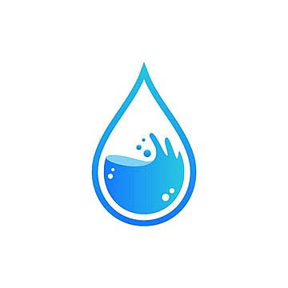

# Air Bersih untuk Semua
Website Edukasi Air Bersih dan Sanitasi Layak
SDG 6 - Clean Water and Sanitation (Air Bersih dan Sanitasi Layak)
## Anggota Kelompok
1. PETRUS M. SINAGA -2515091059- Perancang halaman "Tentang Kami"
2. iyad imanullah -2515091090- Perancang Halaman "Edukasi"
3. Yasir Zulkarnain Ridha -2515091141- Perancang Halaman "Artikel"
4. Ni Kadek Dwipayanti -2515091124- Perancang Halaman "Tips & Aksi"
5. Joel Christo Ginting -2515091136- Perancang Halaman "Beranda"
   
## Deskripsi Website
Air Bersih untuk Semua merupakan website edukasi yang bertujuan meningkatkan kesadaran masyarakat mengenai pentingnya air bersih, sanitasi layak, dan pelestarian sumber daya air. Website ini menyediakan informasi edukatif, panduan praktis, serta artikel yang membantu masyarakat memahami permasalahan air bersih dan menerapkan kebiasaan yang mendukung penggunaan air secara bijak. Website ini ditujukan kepada masyarakat umum agar lebih peduli terhadap kebersihan lingkungan dan keberlanjutan sumber daya air, sesuai dengan tujuan SDG 6.

## Halaman Website
1. Beranda - Memperkenalkan website, tujuan edukasi, dan informasi utama mengenai pentingnya air bersih.
2. Edukasi - Menyajikan materi mengenai air bersih, sanitasi, permasalahan pencemaran, dan pentingnya menjaga sumber air.
3. Panduan - Memberikan tips dan langkah praktis untuk menghemat air serta menjaga kebersihan dan kelestarian sumber air.
4. Artikel - Menyediakan artikel dan informasi pendukung mengenai air bersih, sanitasi, dan pelestarian lingkungan.
5. Tentang - Menjelaskan tujuan website, identitas pengembang, serta referensi informasi yang digunakan.

## Teknologi
1. HTML5 - Digunakan untuk menyusun struktur dan konten setiap halaman website.
2. CSS3 - Digunakan untuk mengatur tampilan, warna, tipografi, jarak, dan tata letak website.
3. Flexbox dan/atau CSS Grid - Digunakan untuk menyusun elemen halaman agar teratur dan fleksibel.
4. CSS Media Queries - Digunakan untuk menyesuaikan tampilan website pada desktop, tablet, dan smartphone.

## Penjelasan Implementasi
### 1. Struktur HTML
HTML5 digunakan untuk membangun struktur setiap halaman website. Elemen semantik seperti header, nav, main, section, article, dan footer digunakan sesuai kebutuhan untuk membuat struktur konten lebih terorganisasi dan mudah dipahami.

### 2. Styling dengan CSS
CSS3 digunakan untuk mengatur desain visual website, termasuk warna, tipografi, ukuran elemen, jarak, dan tampilan komponen. Penggunaan stylesheet eksternal membantu menjaga konsistensi desain pada seluruh halaman.

### 3. Navigasi Website
Navigasi digunakan untuk memudahkan pengunjung berpindah antara halaman Beranda, Edukasi, Panduan, Artikel, dan Tentang. Menu navigasi dibuat konsisten agar pengunjung dapat menemukan informasi yang dibutuhkan dengan mudah.

### 4. Layout dengan Flexbox dan/atau CSS Grid
Flexbox dan/atau CSS Grid digunakan untuk mengatur posisi elemen, menyusun kartu informasi, dan menyesuaikan tata letak konten agar tetap rapi pada berbagai ukuran layar.

### 5. Responsive Design
CSS Media Queries digunakan untuk menyesuaikan tata letak, ukuran teks, gambar, dan navigasi berdasarkan lebar layar perangkat. Responsivitas website diperiksa pada desktop dengan lebar 1440 px, tablet 768 px, dan smartphone 375 px.

### 6. Contoh Implementasi Kode
#### a. Struktur HTML5 dan CSS Eksternal
Berikut potongan kode dari file `index.html`:
```
<!DOCTYPE html>
<html lang="id">
<head>
    <meta charset="UTF-8" />
    <meta name="viewport"
          content="width=device-width, initial-scale=1.0" />
    <meta
        name="description"
        content="Air Bersih untuk Semua adalah website edukasi tentang SDG 6: air bersih, sanitasi, dan konservasi air."
    />
    <title>Air Bersih untuk Semua</title>
    <link rel="stylesheet" href="css/style.css" />
</head>
<body>
    <header class="site-header">
        <!-- Navigasi website -->
    </header>

    <main>
        <!-- Konten utama halaman -->
    </main>
    <!-- Footer website -->
</body>
</html>
```
**Penjelasan kode:**
1. `<!DOCTYPE html>` menyatakan bahwa dokumen menggunakan standar HTML5.
2. `<html lang="id">` menunjukkan bahwa bahasa utama website adalah bahasa Indonesia.
3. `<meta charset="UTF-8">` mengatur pengodean karakter agar teks dapat ditampilkan dengan benar.
4. `<meta name="viewport">` membantu menyesuaikan tampilan website dengan ukuran layar perangkat.
5. `<title>` menentukan judul halaman yang ditampilkan pada tab browser.
6. `<link rel="stylesheet" href="css/style.css">` menghubungkan halaman HTML dengan file CSS eksternal.
7. Elemen `<header>` digunakan untuk bagian kepala website, sedangkan `<main>` menampung konten utama halaman.

#### b. Implementasi Navbar
Berikut potongan kode navigasi dari file `index.html`:
```
<header class="site-header">
    <div class="container topbar">
        <a href="index.html" class="brand"
           aria-label="Air Bersih untuk Semua">
            
            <span>Air Bersih untuk Semua</span>
        </a>

        <nav class="site-nav" aria-label="Navigasi utama">
            <a class="nav-link active"
               href="index.html">Beranda</a>
            <a class="nav-link"
               href="edukasi.html">Edukasi</a>
            <a class="nav-link"
               href="tips.html">Tips &amp; Aksi</a>
            <a class="nav-link"
               href="artikel.html">Artikel</a>
            <a class="nav-link"
               href="tentang.html">Tentang Kami</a>
        </nav>
    </div>
</header>
```
**Penjelasan kode:**
1. `<header class="site-header">` menjadi wadah utama navbar website.
2. `<div class="container topbar">` mengatur area navbar, termasuk posisi logo dan menu navigasi.
3. Elemen `<a class="brand">` menampilkan logo dan nama website. Tautannya mengarah ke halaman beranda.
4. `<nav class="site-nav">` digunakan sebagai wadah menu navigasi utama.
5. Setiap `<a class="nav-link">` menghubungkan pengunjung dengan halaman yang berbeda, yaitu Beranda, Edukasi, Tips & Aksi, Artikel, dan Tentang Kami.
6. Class `active` digunakan untuk membedakan menu halaman yang sedang aktif.

#### c. Pengaturan Layout dengan Flexbox
Berikut potongan kode dari file `css/style.css`:
```
.topbar {
    display: flex;
    align-items: center;
    justify-content: space-between;
    gap: 20px;
    min-height: 78px;
}

.brand {
    display: inline-flex;
    align-items: center;
    gap: 12px;
    font-weight: 700;
    color: var(--primary-dark);
}

.site-nav {
    display: flex;
    align-items: center;
    gap: 18px;
    flex-wrap: wrap;
}
```
**Penjelasan kode:**
1. `display: flex` pada `.topbar` mengatur logo dan navigasi dalam satu tata letak yang fleksibel.
2. `align-items: center` menyelaraskan elemen secara vertikal.
3. `justify-content: space-between` memberikan ruang di antara logo dan menu navigasi.
4. `gap: 20px` mengatur jarak antara elemen di dalam `.topbar`.
5. `display: inline-flex` pada `.brand` menyusun logo dan nama website secara sejajar.
6. `flex-wrap: wrap` pada `.site-nav` memungkinkan menu berpindah ke baris berikutnya jika ruang tidak mencukupi.

#### d. Pengaturan Layout dengan CSS Grid
Berikut contoh kode dari file `css/style.css`:
```
.hero-inner {
    display: grid;
    grid-template-columns: 1.1fr 0.9fr;
    align-items: center;
    gap: 42px;
}

.team-grid {
    display: grid;
    grid-template-columns: repeat(5, minmax(0, 1fr));
    gap: 24px;
}
```
**Penjelasan kode:**
1. `display: grid` digunakan untuk menyusun elemen dalam bentuk kolom dan baris.
2. `grid-template-columns: 1.1fr 0.9fr` membagi area hero menjadi dua kolom dengan perbandingan ukuran 1,1 banding 0,9.
3. `align-items: center` menyelaraskan konten di dalam grid secara vertikal.
4. `repeat(5, minmax(0, 1fr))` membagi area `.team-grid` menjadi lima kolom dengan lebar fleksibel yang sama.
5. `gap: 24px` memberikan jarak antaritem agar tata letak terlihat rapi.

#### e. Implementasi Responsive Design dengan Media Queries
Berikut potongan kode dari file `css/style.css`:
```
@media (max-width: 900px) {
    .hero-inner,
    .content-grid,
    .problem-shell,
    .footer-grid,
    .grid-3,
    .value-grid,
    .article-grid {
        grid-template-columns: 1fr;
    }

    .topbar {
        flex-direction: column;
        padding: 18px 0;
    }
}

@media (max-width: 640px) {
    .site-nav {
        gap: 10px;
    }

    .nav-link {
        padding: 8px 10px;
        font-size: 0.92rem;
    }

    .grid-4,
    .cards-grid,
    .info-grid,
    .team-grid {
        grid-template-columns: 1fr;
    }
}
```
**Penjelasan kode:**
1. `@media (max-width: 900px)` menerapkan aturan CSS ketika lebar viewport tidak lebih dari 900 piksel.
2. `grid-template-columns: 1fr` mengubah sejumlah layout menjadi satu kolom agar konten lebih mudah dibaca pada layar yang lebih kecil.
3. `flex-direction: column` mengubah susunan logo dan navigasi pada `.topbar` menjadi vertikal.
4. `@media (max-width: 640px)` menerapkan penyesuaian tambahan untuk layar smartphone.
5. `gap: 10px` memperkecil jarak antarmenu navigasi.
6. `padding: 8px 10px` menyesuaikan ruang di sekitar teks menu.
7. `font-size: 0.92rem` menyesuaikan ukuran teks navigasi.
8. `grid-template-columns: 1fr` membuat kartu informasi dan anggota kelompok tersusun dalam satu kolom.

Dengan media queries, tata letak website dapat menyesuaikan ukuran layar sehingga konten tetap rapi dan lebih nyaman dibaca pada perangkat yang berbeda.

## Struktur Folder
Air Bersih untuk Semua/
├── CSS/
│   └── style.css
├── images/
├── js/
├── Air Bersih untuk Semua.zip
├── README.md
├── artikel.html
├── edukasi.html
├── index.html
├── tentang.html
└── tips.html

## Website dan Repository
Repository: https://github.com/ptrssng-design/Air-Bersih-untuk-Semua/
Website: https://ptrssng-design.github.io/Air-Bersih-untuk-Semua/

## Referensi
1. Informasi edukasi:
   Sumber: United Nations - Sustainable Development Goal 6, World Health Organization - Water, Sanitation and Health, dan               UNICEF - Water, Sanitation and Hygiene.
   Sumber: WHO - Water, Sanitation and Health dan UNICEF - Water, Sanitation and Hygiene.
   Sumber: United Nations SDG 6, WHO, dan UNICEF.
   URL:
   UN SD 6: https://sdgs.un.org/goals/goal6
   WHO: https://www.who.int/teams/environment-climate-change-and-health/water-sanitation-and-health
   UNICEF: https://www.unicef.org/water-sanitation-and-hygiene-wash

2. Gambar:
   dari google


   
